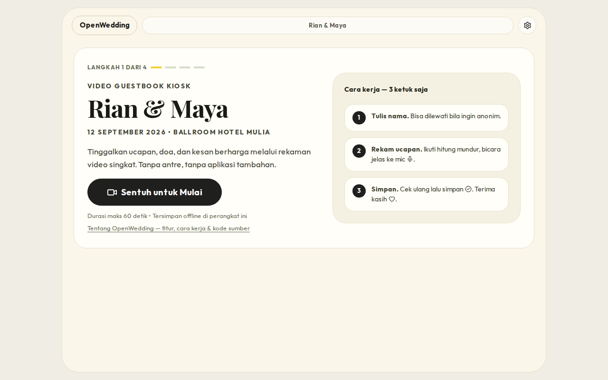

# OpenWedding — Video Guestbook Kiosk

**Video guestbook offline-first untuk pernikahan & event spesial.**
Tamu merekam pesan video singkat langsung di lokasi acara — tanpa aplikasi
tambahan, tanpa antre, tanpa internet. Semua rekaman tersimpan di perangkat
acara dan bisa di-export jadi satu ZIP setelah acara selesai.

🔗 **Live demo:** https://video-guess-book.pages.dev
💻 **Kode sumber:** https://github.com/dezzorigin/video-guess-book

> Nama repo (`video-guess-book`) adalah nama historis; nama produknya
> **OpenWedding** — kiosk video guestbook, bukan game tebak video.



## Demo

| | |
|---|---|
| 🎬 Video demo (alur tamu penuh) | [docs/demo/demo.mp4](docs/demo/demo.mp4) |
| 🖼️ Screenshot | [docs/screenshots/](docs/screenshots/) |

## Cara kerja — 4 langkah tamu

1. **Tulis nama** — di layar sambutan, ketuk *Sentuh untuk Mulai*, tulis nama
   (atau *Lewati* untuk anonim).
2. **Hitung mundur** — layar persiapan 3 detik sebelum kamera mulai merekam.
3. **Rekam ucapan** — kamera fullscreen + timer + visual mic. Durasi bisa
   diatur operator (default 60 detik); berhenti otomatis saat waktu habis.
4. **Tinjau & simpan** — putar ulang rekaman, lalu *Simpan Ucapan* (atau
   *Ulangi Rekam*). Layar terima kasih + confetti, lalu kembali ke sambutan
   sendiri dalam 8 detik.

## Fitur

| Fitur | Keterangan |
|---|---|
| **Offline-first PWA** | Service worker (Workbox `generateSW`, 49 entri precache) + manifest lengkap — aplikasi & font self-hosted tersimpan di perangkat; jalan tanpa internet. Bisa di-install (Add to Home Screen). |
| **Multi-event** | Satu perangkat untuk banyak acara: buat event baru (nama mempelai, tanggal/lokasi, tema, durasi), ganti event aktif; video tiap event terpisah. |
| **5 tema pastel** | Classic Gold, Sage Green, Blush Pink, Lavender Mist, Sky Blue — dipilih operator per event. |
| **Dashboard operator (PIN)** | EO Control Center: statistik (jumlah video, total ukuran, sisa storage), galeri video (putar/hapus), kelola event, pilih kamera/mikrofon + tes mic, export. PIN default `1234` — **ganti sebelum dipakai di acara nyata**. Buka lewat ikon gerigi, ketuk 5× nama mempelai, atau hash `#admin`. |
| **Export ZIP** | Semua video + daftar tamu CSV + rekap TXT dibungkus jadi satu `.zip` siap diserahkan ke pengantin. |
| **Landing page** | Halaman pengenalan produk (`#landing`): navbar + tautan GitHub, hero + pratinjau, fitur, cara kerja, footer. |
| **Tanpa server** | Tidak ada backend, database, atau akun. Semua data di perangkat (IndexedDB + localStorage). |

## Tech stack

- **Vite 5 + React 19** (JSX, tanpa TypeScript)
- **vite-plugin-pwa 0.20** — Workbox `generateSW`, `registerType: autoUpdate`
- **IndexedDB** (`OpenWeddingDB` v2: store `videos` + `events`) & localStorage (konfigurasi)
- **MediaRecorder API** — rekam video (MP4/WebM sesuai dukungan browser) + Web Audio visualizer mic
- **JSZip** — bundel export ZIP; **lucide-react** — ikon
- **Playwright** — e2e dengan kamera/mik palsu

## Menjalankan lokal

```bash
npm install
npm run dev        # dev server Vite (tanpa service worker)
npm run build      # build produksi + generate service worker
npm run preview    # sajikan hasil build (dengan service worker + PWA)
npm run pwa:audit  # audit manifest + service worker hasil build
npx playwright test e2e/smoke.spec.js   # e2e (butuh Chromium Playwright)
```

Butuh browser dengan kamera/mikrofon (atau kamera palsu) untuk merekam.
Di Chrome desktop, izinkan akses kamera/mik saat diminta. Uji e2e memakai
`--use-fake-device-for-media-stream` sehingga tidak butuh perangkat keras.

## Struktur proyek

```
index.html                  # SEO/OG/PWA meta, canonical live
vite.config.js              # Vite + VitePWA (manifest dideklarasi eksplisit)
styles.css                  # Design system + gaya kiosk + landing
public/
  manifest.webmanifest      # Manifest PWA (cerminan vite.config.js)
  icons/  fonts/  img/      # Ikon PWA, font self-hosted (Outfit + Playfair), pratinjau
src/
  main.jsx  App.jsx         # Entrypoint; routing hash (#landing, #admin)
  context/KioskContext.jsx  # State pusat: layar, config, event aktif, sesi tamu
  components/screens/       # Welcome, GuestName, Greeting, Recording, Preview, ThankYou, Landing
  components/modals/        # PinModal, OperatorDashboard, ExportModal, ConfirmModal
  services/                 # storage.js (IndexedDB), media.js (kamera/mik), exportService.js (ZIP/CSV/TXT)
  constants/themes.js       # 5 tema pastel
  utils/confetti.js         # Confetti layar terima kasih
scripts/
  advisory-sweep.py         # Sweep OSV batch (tanpa auth) untuk dependensi produksi
  pwa-audit.mjs             # Audit manifest + service worker hasil build
e2e/                        # Playwright smoke + demo (screenshot & video)
docs/                       # PRD, arsitektur, panduan, deployment, diagram, demo
```

## Dokumentasi

- [docs/PRD.md](docs/PRD.md) — PRD (ruang lingkup, fitur, kriteria keberhasilan)
- [docs/ARCHITECTURE.md](docs/ARCHITECTURE.md) — arsitektur, alur data, penyimpanan
- [docs/USER-GUIDE.md](docs/USER-GUIDE.md) — panduan tamu & operator (termasuk checklist hari-H)
- [docs/DEPLOYMENT.md](docs/DEPLOYMENT.md) — deploy Cloudflare Pages + CI
- [docs/DIAGRAMS.html](docs/DIAGRAMS.html) — diagram arsitektur & alur (HTML+SVG)
- [docs/DEMO.md](docs/DEMO.md) — cara merekam ulang demo & screenshot

## Keamanan & privasi

- **Tidak ada secret di repo.** Tidak ada `.env`, API key, atau kredensial
  yang ter-commit. Satu-satunya yang pernah ter-commit adalah cache Wrangler
  lokal (`.wrangler/cache/` berisi Cloudflare **account id** + nama akun —
  bukan token) — sudah dihapus dari tree di PR ini dan `.wrangler/` masuk
  `.gitignore`.
- **PIN operator default `1234`** disimpan di localStorage (bukan rahasia
  kuat — ini kiosk lokal, bukan autentikasi server). Ganti PIN dari dashboard
  sebelum acara.
- **Video tidak pernah keluar dari perangkat** kecuali operator sengaja
  export ZIP. Tidak ada upload, analytics, atau pihak ketiga.
- Dependensi produksi di-sweep tiap CI via OSV batch
  (`scripts/advisory-sweep.py`) — HIGH/CRITICAL menggagalkan CI.

## Lisensi

MIT — lihat [LICENSE](./LICENSE). Dibuat oleh **dezzorigin** (Nabil Aulia Dika).
