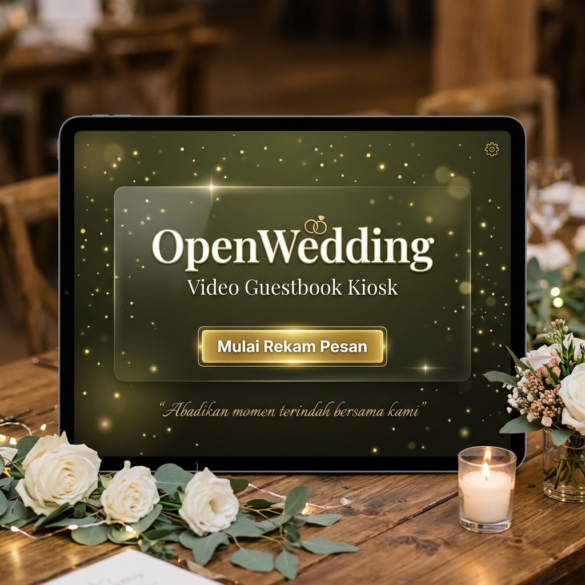
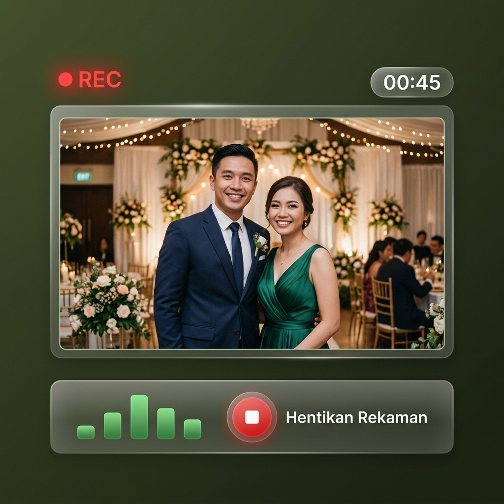
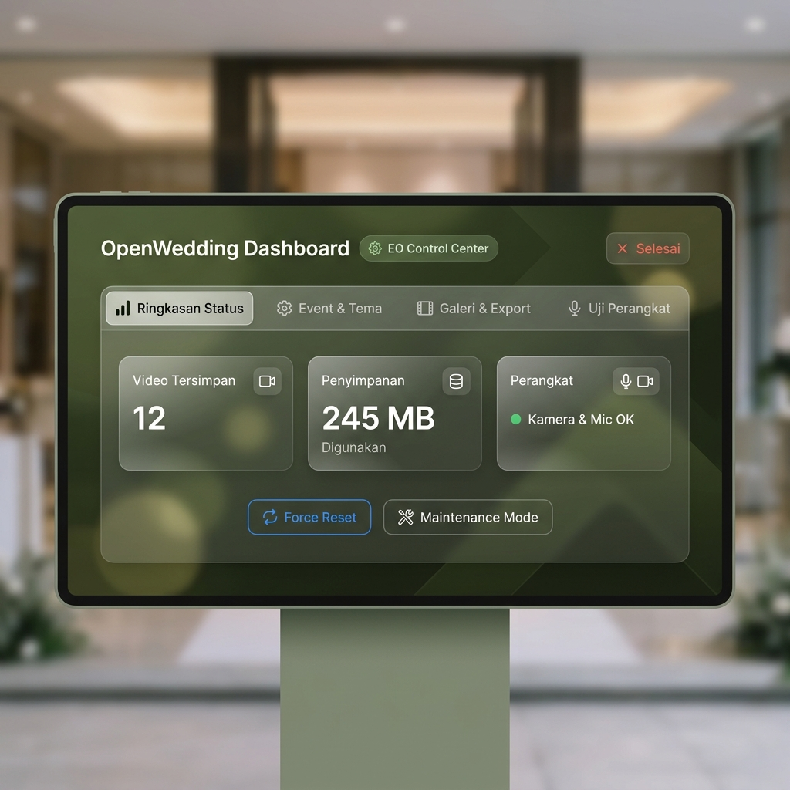

# 🎬 OpenWedding — Video Guestbook Kiosk

> Buat momen pernikahanmu makin berkesan. Tamu bisa ninggalin pesan video langsung dari kiosk, dan semuanya tersimpan rapi secara lokal — bahkan tanpa koneksi internet.

<div align="center">

[](https://openwedding.pages.dev)
[](https://openwedding.pages.dev)
[](https://openwedding.pages.dev)

</div>

---

## 📸 Preview

**Welcome Screen — Tampilan Kiosk di Venue**


**Recording Screen — Tamu Sedang Merekam Pesan**


**Operator Dashboard — Kontrol Panel EO**


---


## Apa itu OpenWedding?

OpenWedding adalah aplikasi **video guestbook** berbasis browser yang dirancang buat kiosk pernikahan. Bayangkan ada iPad atau layar touchscreen di sudut venue, dan tamu-tamu bisa rekam pesan video untuk mempelai — semua berjalan mulus, offline, tanpa perlu server atau cloud storage.

Cocok banget buat:
- 💒 Pernikahan & Resepsi
- 🎂 Ulang Tahun Spesial
- 🎓 Wisuda & Pesta Kelulusan
- 🥂 Event formal lainnya

---

## ✨ Fitur Utama

| Fitur | Deskripsi |
|-------|-----------|
| 🎥 **Rekam Video** | Langsung dari kamera perangkat, durasi bisa diatur bebas |
| 📴 **Offline First** | Bekerja 100% tanpa internet setelah pertama kali dimuat (PWA) |
| 💾 **Simpan Lokal** | Video langsung tersimpan ke folder yang ditentukan operator |
| ⚙️ **Mode Operator** | Panel pengaturan lengkap untuk kustomisasi event per sewa |
| 📋 **Preset Sewa** | Simpan & load profil pengaturan untuk tiap event berbeda |
| 🎬 **Media Penyambut** | Putar video/audio sambutan sebelum tamu mulai rekam |
| 🌿 **Desain Elegan** | Palet warna olive, sage, krem & dusty rose — cocok buat wedding |
| 📱 **Installable PWA** | Bisa diinstall di iPad/tablet sebagai standalone app |

---

## 🚀 Cara Pakai (untuk Operator)

### 1. Setup Awal (Pertama Kali)

Buka OpenWedding di browser. Kalau belum ada preset tersimpan, **Operator Setup Modal** akan langsung muncul.

Isi informasi event di tab **Info Acara**:
- Nama pasangan pengantin
- Tanggal & lokasi acara
- Durasi maksimal rekaman (30s, 60s, 90s, atau 120s)

### 2. Upload Media Opsional

Di tab **Media & Video**, kamu bisa upload:
- **Video background** untuk layar sambutan (MP4/WebM)
- **Klip video sambutan** dari mempelai yang diputar sebelum tamu rekam
- Atau **pesan audio** kalau mau suara saja

### 3. Pilih Folder Penyimpanan

Di tab **Simpan & Kamera**, klik **Pilih Folder Penyimpanan Lokal** dan arahkan ke folder tempat video tamu akan tersimpan. Kamera & mikrofon juga bisa dicek langsung dari sini.

### 4. Simpan Preset (Opsional tapi Recommended)

Di tab **Profil & Preset**, simpan pengaturan saat ini dengan nama preset (misal: "Wedding Sophia & Alex"). Lain kali buka app, langsung pilih preset dan kiosk siap jalan tanpa setup ulang.

### 5. Jalankan Kiosk

Klik **Jalankan Kiosk Mode** — layar akan full screen, kamera aktif, dan kiosk siap dipakai tamu.

---

## 🎭 Alur untuk Tamu

```
[Layar Sambutan] → Tap "Start Recording"
       ↓
[Countdown 3-2-1]
       ↓
[Rekam Pesan Video]
       ↓
[Review & Preview]
       ↓  
[Simpan] → Terima Kasih! → Balik ke Layar Sambutan
```

---

## 🔧 Menu Operator Tersembunyi

Tekan & tahan **pojok kanan bawah layar** selama **3 detik** untuk membuka menu operator tersembunyi. Dari sini kamu bisa:
- Kembali ke pengaturan event
- Reset sesi tamu saat ini
- Keluar fullscreen / tutup kiosk

Ada juga tombol **⚙️ gear** kecil di pojok kiri atas layar sambutan untuk akses cepat ke panel pengaturan.

---

## 💻 Untuk Developer

### Prasyarat

- Node.js v18+
- npm

### Install & Development

```bash
# Clone / download project ini
cd openwedding

# Install dependencies
npm install

# Jalankan dev server
npm run dev
```

### Build Production

```bash
npm run build
```

Output akan ada di folder `dist/`.

### Deploy ke Cloudflare Pages

```bash
# Satu perintah untuk build + deploy
npm run deploy

# Atau manual:
npm run build
npx wrangler pages deploy dist --project-name=openwedding --force
```

### Struktur Folder

```
openwedding/
├── index.html              # Halaman utama kiosk
├── styles.css              # Design system & semua styling
├── sw.js                   # Service Worker (offline-first PWA)
├── manifest.webmanifest    # PWA manifest
├── vite.config.js          # Konfigurasi build Vite
├── package.json
│
├── js/
│   ├── main.js             # Entry point utama
│   └── modules/
│       ├── config.js       # Konfigurasi default event
│       ├── elements.js     # Registry semua DOM elements
│       ├── state.js        # State management & preset storage
│       ├── media.js        # Kamera, mikrofon & codec detection
│       ├── storage.js      # File System Access API & download fallback
│       ├── reliability.js  # Wake Lock, Fullscreen & idle timer
│       ├── screens.js      # Flow antar screen & recording logic
│       └── operator.js     # Panel operator & preset manager
│
├── fonts/                  # Self-hosted fonts (Outfit + Playfair Display)
├── icons/                  # PWA icons (192px, 512px, SVG, Apple)
└── public/                 # Static assets (di-copy langsung ke dist/)
    ├── sw.js
    ├── manifest.webmanifest
    ├── fonts/
    └── icons/
```

---

## 🌐 PWA Offline

OpenWedding menggunakan **Service Worker** dengan strategi **Cache-First**:

- Saat pertama kali dibuka (dengan internet), semua asset dicache otomatis
- Setelah itu, app berjalan **100% offline** — cocok untuk venue tanpa WiFi
- Video tamu tersimpan langsung ke device, tidak perlu upload ke mana-mana

### Install sebagai App di iPad/Tablet

1. Buka di Safari (iOS) atau Chrome (Android)
2. Tap ikon "Share" → "Add to Home Screen"
3. OpenWedding akan jalan sebagai standalone app tanpa browser UI

---

## 🎨 Palet Warna

Desain OpenWedding pakai palet yang hangat dan elegan:

| Nama | Hex | Penggunaan |
|------|-----|-----------|
| Olive Green | `#7E7F4C` | Aksen utama, border |
| Sage Green | `#A5AA87` | Background card, particle |
| Cream | `#F6F1DF` | Background utama |
| Dusty Rose | `#D28E96` | Tombol primer |
| Mauve | `#9B6774` | Tombol primer (hover) |

Font: **Playfair Display** (heading) + **Outfit** (body) — keduanya self-hosted untuk support offline.

---

## 📄 Lisensi

MIT License — bebas dipakai, dimodifikasi, dan didistribusikan.

---

<p align="center">
  Made with 💜 for wedding moments that last forever.<br>
  <sub>OpenWedding — Offline. Elegant. Yours.</sub>
</p>
